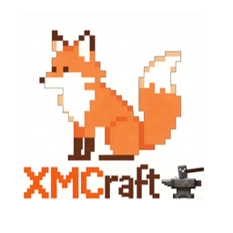

[简体中文](README.md) | **English** | [繁體中文](README-ZH_TW.md)

<div align="center">



# PCL-DreamPort

[](https://github.com/XiamengYaro/PCL-DreamPort/)


[](https://github.com/XiamengYaro/PCL-DreamPort/issues)
[](https://github.com/XiamengYaro/PCL-DreamPort/pulls)

[](https://xmcraft.cn) <br />

[Download](https://github.com/XiamengYaro/PCL-DreamPort/releases/latest) |
[DreamPort Website](https://xmcraft.cn) |
[Upstream PCL](https://github.com/Meloong-Git/PCL) |
[Upstream PCL CE](https://github.com/PCL-Community/PCL-CE)

[Submit issues](https://github.com/XiamengYaro/PCL-DreamPort/issues/new/choose) |
[Contribution Guidelines](CONTRIBUTING.md)

</div>

`PCL-DreamPort` (in-app display name: `PCL-梦港`) is the dedicated launcher for the DreamPort Minecraft server and an independent cross-platform derivative built upon [Plain Craft Launcher (PCL)](https://github.com/Meloong-Git/PCL) and [PCL Community Edition (PCL CE)](https://github.com/PCL-Community/PCL-CE).

> **Independent Derivative Notice**: Version numbers in this repository do not correspond strictly to upstream PCL or PCL CE, and this project is not affiliated with LTCat or PCL Official. Please do not report issues from this fork to the upstream PCL or PCL CE repositories.

## Key Modifications & Added Capabilities

- **Appearance, Themes & Cross-Platform Experience**
  - **Tianyi Blue Default Theme**: Adds the Tianyi Blue (`#66CCFF`) theme palette and sets it as the default accent for both Light and Dark modes while preserving dark surface contrast in Dark mode.
  - **macOS Custom Borderless Title Bar**: Defaults macOS windows to a frameless custom title bar (`WindowDecorations.BorderOnly`, hiding the native macOS title bar and traffic lights while rendering custom minimize/close buttons and retaining native rounded corners, drop shadow, and 8-direction edge resizing; switchable between Separate, Unified, and Custom under **Settings -> Personalization -> macOS title bar style**).
  - **Platform Polish & Isolation**: Updated macOS Dock icon padded to Apple HIG proportions; launcher data isolated in `PCL-DreamPort` without overwriting existing PCL CE data; Java auto-discovery across `PATH`, `JAVA_HOME`, and macOS system/user `JavaVirtualMachines` directories; fixed initial right-side homepage focus scrolling to the middle on startup.
- **Compliance Base, Official-Account Scope & Source Isolation**
  - **Official Microsoft Accounts Only**: Removes offline and third-party authlib login entries while retaining Microsoft login with built-in device-code QR rendering.
  - **Preserved Upstream Compliance**: Keeps dual licensing, top attribution and sponsorship link for original author LTCat in the About page, launch precheck prompts (`McLaunchPrecheck`), Windows blue-hue locking, and completely disables upstream Sentry telemetry, multiplayer stats, and MirrorChyan.
  - **Download & Update Mirror Separation**: Removes China Mainland region blocks on Minecraft downloads, asset completion, and modpack installs; game data downloads continue to use native Official / BMCLAPI sources with an isolated User-Agent (`PCL-DreamPort/{version}`), reserving `https://dl.xmcraft.cn` (`DP_UPDATE_MIRROR_URL`) strictly for launcher updates and companion services.
- **DreamPort Account, Onboarding Flow & Community Integration**
  - **Account & Session Management**: `Tools -> DreamPort Account` supports browser-confirmed and mobile QR login (`/api/qr-login/*`), OS-encrypted credential storage (DPAPI / Keychain), explicit distinction between expired sessions (401) and transient network errors, and active device listing with single/bulk revocation (`/api/auth/sessions*`).
  - **Native Six-Step Server Onboarding**: Integrates `/api/user/progress` for QQ bind/unbind (`/api/user/qq/*`), one-click ownership verification using the active Microsoft profile or fallback device-code verification (`POST /api/user/minecraft/verify-token`), invite code redemption (`POST /api/invite/apply`), interactive admission questionnaire with SSE live per-question AI grading (`/api/questionnaire/{config,stream,submit}`), and rejection/ban appeal workflows (`/api/questionnaire/appeal*`).
  - **Points, Titles, Announcements & Live Homepage**: Automatic once-per-day silent check-in on startup for approved players (`POST /api/points/signin`), points & title equipping (`/api/points/center`, `/api/titles/*`), `Tools -> Announcements & Notifications` with live unread badge in the title bar (`/api/announcements`, `/api/notifications*`), and enforced site-pushed homepage syncing via `GET /api/client/pcl-homepage` with silent fallback to the built-in XAML prototype only when offline or unreachable.
- **DreamPort Relay Multiplayer (TCP/TLS Relay)**
  - Completely removes EasyTier and Natayark ID, replacing them with a native TCP/TLS relay lobby backed by `DreamPort-Relay` and LAN broadcast discovery: `/realtime` WebSocket updates (with 30s polling fallback), hosting via `224.0.2.60:4445` multicast + `latest.log` regex fallback + local port probing, SLP and mod inventory reporting, 10-second `host_status` grace keepalive, member kick/unban, friend invite/revoke, stale-room recovery, automatic room shutdown on exit, version/loader/mod compatibility checks before joining, and multi-connection forwarding with LAN spoofing.
- **Sync Utilities & AI Assistance**
  - **Dual-Source Mod Sync, Cloud Saves & Profile Sync**: `Tools -> Sync & Tools` provides serverpack + Modrinth mod sync (pre-checks MC version/loader, protects core files plus user-installed and `.disabled` mods, verifies SHA-256/512), streaming ZIP world backups (skips `session.lock`, chunked resume upload, Zip-Slip protection, non-destructive rename avoidance on restore), and whitelisted portable settings sync using optimistic `revision` conflict resolution while strictly excluding credentials and local paths.
  - **AI Log Diagnostics & Resource Explainer**: `Tools -> AI Diagnostics` reads bounded tail logs and redacts player names, user paths, and tokens locally before submitting async diagnosis (`/api/ai/log-diagnose*`); resource detail pages include `AI Feature Summary` (`/api/ai/resource/explain`).
- **Dual-Source Auto-Updater & Minimal Heartbeat**
  - **Auto-Updater**: Prioritizes `dl.xmcraft.cn/pcl-dreamport/{beta/}latest.json` (validating schema, product ID, HTTPS URL, and 64-char SHA-256), falling back silently to GitHub Releases + `SHA256SUMS` across all 6 OS/arch targets (`.exe`, `.zip`, `.dmg`, `AppImage`, `.deb`, `.rpm`). Selects OS/arch-matched packages suitable for in-app updates, persists skipped versions, verifies `.dp-update-part` downloads via SHA-256, and performs self-replacement on Windows or `ditto` + `open -n` relaunch on macOS.
  - **Minimal Online Heartbeat**: Only reports lightweight online status (`/api/client/heartbeat` containing `clientVersion`, `platform`, and `clientStartedAt`) while signed into a DreamPort account without uploading mods or local settings, and notifies `/api/client/offline` on logout or exit.

## Supported Platforms

This repository keeps the upstream `.NET 10` lightweight `--no-self-contained` distribution strategy:

### Windows

| Version | Architecture | Support | Requirements |
|---|---|---|---|
| Windows 10 1809 (17763) or later, or Windows 11 | x64, ARM64 | ✓ Fully supported | [.NET 10 Desktop Runtime](https://get.dot.net/10) |
| Windows 10 1607 (E) | x64 | △ Expected to run; best-effort support | [.NET 10 Desktop Runtime](https://get.dot.net/10) |
| Windows 8.1, 8, 7 or earlier | / | ✗ Not supported | / |

<small>`(E)` means Enterprise or ESU editions. .NET 10 officially supports Windows 10 1607 and 1809 only on these editions.</small>

### Linux

| Distribution | Architecture | Support | Requirements |
|---|---|---|---|
| Common glibc desktop distributions<br>(Ubuntu 22.04 or later, Fedora 43 or later, Arch Linux, etc.) | x64 | ✓ Supported | [.NET 10 Runtime](https://get.dot.net/10), X11, Wayland experimental |
| Same as above | ARM64 | ✓ Supported | [.NET 10 Runtime](https://get.dot.net/10), X11 |
| Other glibc desktop distributions | x64, ARM64 | △ Expected to run; best-effort support | Requires glibc 2.27 or later and a working X11 desktop |
| Alpine and other musl distributions | x64, ARM64 | ✗ Not supported | Current artifacts have not been tested on musl |

<small>X11 is used by default. Set `PCL_USE_WAYLAND=1` to try native Wayland (falls back to X11 automatically if initialization fails). Wayland also requires `libwayland-client` and `libxkbcommon`.</small>

### macOS

| Version | Architecture | Support | Requirements |
|---|---|---|---|
| macOS 12 or later | Apple Silicon (ARM64), Intel (x64) | ✓ Supported | [.NET 10 Runtime](https://get.dot.net/10) |

<small>**First Launch on macOS**: Public builds are currently ad-hoc signed without Apple Developer ID notarization. After downloading from official Releases or `dl.xmcraft.cn`, remove the quarantine attribute if macOS blocks launch:</small>

```bash
xattr -dr com.apple.quarantine '/Applications/PCL-梦港.app'
open '/Applications/PCL-梦港.app'
```

**✓ Fully supported**: Actively maintained with compatibility fixes; please keep updated to the latest release.

**△ Expected to run; best-effort support**: Usually works, though full compatibility is not guaranteed. Upgrading to a supported OS version is recommended.

**✗ Not supported**: Generally cannot run or start properly. Please upgrade your operating system before running PCL-DreamPort.

**Note**:
- Support is only provided for the latest release.
- Issues caused by missing OS components or outdated environments require updating the system environment first.
- Newer OS releases are recommended for the best experience.

## Build & Environment Variables

Building this repository requires **.NET 11 SDK** (solutions target `net10.0`, `LangVersion 15.0`).

```bash
# Build Debug / Release
dotnet build "PCL Community Edition.slnx" -c Debug
dotnet build "PCL Community Edition.slnx" -c Release

# Run tests
dotnet test DreamPort.Test/DreamPort.Test.csproj -c Debug
dotnet test PCL.Core.Test/PCL.Core.Test.csproj -c Debug

# Cross-platform lightweight packaging (--no-self-contained; CI generates SHA256SUMS for auto-updates)
PCL_SKIP_CODESIGN=1 bash scripts/package-macos.sh osx-arm64 Release 0.1.10 dist
bash scripts/publish-windows.sh win-x64 Release dist
bash scripts/publish.sh linux-x64 Release dist
```

Windows produces a single-file `PCL.Launcher.exe`, which release workflows rename with version and architecture suffixes.

| Environment Variable / Build Arg | Default | Description |
|---|---|---|
| `DP_BASE_URL` | `https://xmcraft.cn` | DreamPort site root URL |
| `DP_REPO_URL` | `https://github.com/XiamengYaro/PCL-DreamPort` | Public source repository URL |
| `DP_UPDATE_MIRROR_URL` | `https://dl.xmcraft.cn` | Companion/update mirror URL (not used for game data downloads) |
| `PCL_MS_CLIENT_ID` | (Required) | Azure Client ID for Microsoft login (build-time; `DP_MS_CLIENT_ID` in Debug) |

## AI Assistance Disclosure

This repository utilizes **Antigravity** powered by **Gemini Neon / Hydrogen** models to assist with derivative feature implementation, test authoring, and documentation maintenance, with changes verified through local builds and unit tests.

## License

- `PCL.Launcher/` and `PCL.Launcher.Core/` strictly follow the [PCL Custom Limited Distribution License & Fair Use Guide](PCL.Launcher.Core/LICENCE)
- `DreamPort.Core/`, `DreamPort.UI/`, `DreamPort.Test/`, and all other directories are licensed under [Apache License 2.0](LICENSE) (see [NOTICE](NOTICE) for derivative changes and attribution)

## Statistics

[](https://www.star-history.com/#XiamengYaro/PCL-DreamPort&Date)

## Contributors

Special thanks to LTCat and the upstream [PCL Community Edition](https://github.com/PCL-Community/PCL-CE) contributors, as well as everyone contributing to `PCL-DreamPort`:

[](https://github.com/XiamengYaro/PCL-DreamPort/graphs/contributors)
