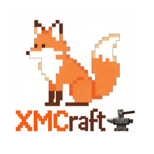

[简体中文](README.md) | [English](README-EN.md) | **繁體中文**

<div align="center">



# PCL-夢港 (PCL-DreamPort)

[](https://github.com/XiamengYaro/PCL-DreamPort/)


[](https://github.com/XiamengYaro/PCL-DreamPort/issues)
[](https://github.com/XiamengYaro/PCL-DreamPort/pulls)

[](https://xmcraft.cn) <br />

[最新版本下載](https://github.com/XiamengYaro/PCL-DreamPort/releases/latest) |
[夢港官網](https://xmcraft.cn) |
[PCL 上游](https://github.com/Meloong-Git/PCL) |
[PCL CE 上游](https://github.com/PCL-Community/PCL-CE)

[提交問題](https://github.com/XiamengYaro/PCL-DreamPort/issues/new/choose) |
[貢獻指南](CONTRIBUTING.md)

</div>

PCL-夢港（`PCL-DreamPort`）是面向夏日小鎮 · 夢港伺服器的專用啟動器，也是第三方基於 [Plain Craft Launcher (PCL)](https://github.com/Meloong-Git/PCL) 與 [PCL Community Edition (PCL CE)](https://github.com/PCL-Community/PCL-CE) **獨立二次創作**的跨平台衍生修改版。

> **獨立二次創作聲明**：本分支的版本號與原版 PCL / PCL CE 並非嚴格對應關係，**與龍騰貓躍及 PCL 官方無關聯**。請勿向 PCL 或 PCL CE 上游儲存庫回報本分支的問題。

## 相對上游的主要修改與新增能力

- **外觀主題與跨平台體驗**
  - **天依藍預設主題**：新增天依藍（`#66CCFF`）主題配色，並將淺色與深色模式預設配色均設為天依藍，同時確保深色模式下表面層級保持暗色對比度。
  - **macOS 自繪標題列**：macOS 預設啟用無系統標題列的「自繪標題列」（隱藏系統標題列與紅黃綠按鈕，右上角顯示最小化與關閉按鈕並保留原生圓角、陰影與八方向邊緣縮放；支援於「設定 → 個人化 → macOS 標題列樣式」切換為獨立、融入或自繪樣式）。
  - **細節與環境適配**：重繪符合 Apple HIG 規範的 macOS 圓角應用圖示；應用資料目錄獨立隔離為 `PCL-DreamPort`，不覆蓋原有 PCL CE 資料；Java 自動探索涵蓋 `PATH`、`JAVA_HOME` 及 macOS 系統/使用者級 `JavaVirtualMachines`；修復啟動後右側主頁焦點誤捲動至頁面中段的問題。
- **合規底座、正版收斂與來源隔離**
  - **僅正版遊戲帳號**：停用離線登入與外置登入入口，保留微軟正版登入並內建裝置碼 QR Code 算繪。
  - **合規約束保留**：嚴格保留雙授權架構、「關於」頁首位原作者龍騰貓躍署名與贊助連結及啟動勸導流程（`McLaunchPrecheck`）；Windows 介面主色相鎖定 PCL 藍色系；徹底停用上游 Sentry 遙測、連線統計與 MirrorChyan 來源。
  - **下載與加速來源分工**：移除中國大陸地區的 Minecraft 下載、補全與整合包安裝區域限制；遊戲資料下載沿用 PCL 原生官方源 / BMCLAPI 並隔離下載層 User-Agent（`PCL-DreamPort/{version}`），夢港加速源（`https://dl.xmcraft.cn`，`DP_UPDATE_MIRROR_URL`）僅用於啟動器更新等配套服務。
- **夢港帳號、入服引導與社群整合**
  - **帳號與多裝置工作階段**：「工具 → 夢港帳號」支援瀏覽器確認與同碼手機掃碼登入（`/api/qr-login/*`）、系統憑據庫加密儲存（DPAPI / Keychain）、嚴格區分工作階段過期（401）與網路波動，並支援查看活躍裝置與單一/批次踢除（`/api/auth/sessions*`）。
  - **原生六步入服引導**：串接 `/api/user/progress`，於啟動器內原生完成 QQ 綁定/解綁（`/api/user/qq/*`）、使用目前登入的微軟正版檔案一鍵驗證或裝置碼備援驗證（`POST /api/user/minecraft/verify-token`）、邀請碼入服（`POST /api/invite/apply`）、可互動入服問卷與 SSE 即時逐題 AI 評分回饋（`/api/questionnaire/{config,stream,submit}`），以及拒絕/封禁引導與人工複核申訴（`/api/questionnaire/appeal*`）。
  - **積分、稱號、公告與自訂主頁**：啟動時自動為已過審玩家每日靜默簽到一次並去重（`POST /api/points/signin`），支援查看積分/任務並配戴或卸下稱號（`/api/points/center`、`/api/titles/*`）；新增「工具 → 公告與通知」及標題列右上角未讀通知角標（`/api/announcements`、`/api/notifications*`）；主頁強制串接站點推送主頁並與快取版本比對（`GET /api/client/pcl-homepage`），支援 Hero 背景、輪播圖、照片牆與公告同步，僅在離線或不可達時靜默回退至本機內建 XAML 原型。
- **夢港連線（TCP/TLS 中繼）**
  - 完全移除 EasyTier 與 Natayark ID，原生實作僅基於 `DreamPort-Relay` 的 TCP/TLS 中繼大廳與區域網路廣播探索：支援 `/realtime` WebSocket 秒級狀態更新（斷線自動回退 30 秒輪詢）、單人開房（`224.0.2.60:4445` 群播監聽 + 遊戲 `latest.log` 埠號正規表示式備援與本機探活、SLP/本機模組掃描回報、10 秒 `host_status` 寬限保活、踢出/解禁、好友邀請與撤回、殘留房間自救與結束自動關房），以及好友/公開大廳加房（相容度排序、Forge/NeoForge 載入器與模組差異硬攔截、版本差異確認、多連線併發轉發與區域網路偽裝廣播）。
- **同步工具與 AI 輔助**
  - **雙源模組同步、雲端存檔與設定雲同步**：「工具 → 同步與工具」串接 `/api/client/serverpack` 與 Modrinth 雙源模組清單（版本/載入器前置校驗、路徑越界與核心檔案保護、保留玩家自裝與 `.disabled` 模組、SHA-256/512 校驗）；支援串流存檔 ZIP 打包雲端備份（略過 `session.lock`、分塊斷點續傳、Zip-Slip 校驗與還原時同名避讓）；支援多裝置白名單可攜設定雲端同步（樂觀鎖 `revision` 衝突由玩家顯式決策，嚴格排除帳號憑據與本機路徑參數）。
  - **AI 排障與資源解析**：「工具 → AI 排障」支援讀取目前執行個體記錄檔並於本機完成有界擷取及玩家名/路徑/權杖去識別化後非同步診斷（`/api/ai/log-diagnose*`）；社群資源詳情頁提供「AI 功能解析」（`/api/ai/resource/explain`）。
- **雙源自動更新與極簡心跳**
  - **自動更新**：啟動檢查與「設定 → 更新」優先校驗 `dl.xmcraft.cn/pcl-dreamport/{beta/}latest.json`（嚴格校驗 schema / product / HTTPS / 64 位元 SHA-256），任一不通過即靜默回落 GitHub Releases + `SHA256SUMS`（涵蓋 Windows/macOS/Linux 六平台 `.exe`、`.zip`、`.dmg`、`AppImage`、`.deb`、`.rpm`）；依 OS + 架構精準匹配應用內更新安裝包格式，支援「略過此版本」、`.dp-update-part` 落盤校驗、Windows 原地自替換與 macOS `.app` 一鍵 `ditto` + `open -n` 重啟。
  - **極簡線上心跳**：僅於登入夢港帳號後回報基礎線上狀態（`/api/client/heartbeat` 僅含 `clientVersion` / `platform` / `clientStartedAt`），不上傳模組或本機設定；登出、切換站點或結束自動回報 `/api/client/offline`。

## 支援平台

本倉延續上游 `.NET 10` 輕量非自包含（`--no-self-contained`）建置與分發策略：

### Windows

| 版本 | 架構 | 支援情況 | 環境要求 |
|---|---|---|---|
| Windows 10 1809 (17763) 及以上，或 Windows 11 | x64、ARM64 | ✓ 完整支援 | [.NET 10 Desktop Runtime](https://get.dot.net/10) |
| Windows 10 1607 (E) | x64 | △ 理論能跑，酌情支援 | [.NET 10 Desktop Runtime](https://get.dot.net/10) |
| Windows 8.1、8、7 及更低版本 | / | ✗ 不支援 | / |

<small>`(E)` 指 Enterprise 或 ESU 版本。.NET 10 對 Windows 10 1607 和 1809 的官方支援僅限這些版本。</small>

### Linux

| 發行版 | 架構 | 支援情況 | 環境要求 |
|---|---|---|---|
| 常見 glibc 桌面發行版<br>（Ubuntu 22.04 及以上、Fedora 43 及以上、Arch Linux 等） | x64 | ✓ 支援 | [.NET 10 Runtime](https://get.dot.net/10)、X11、Wayland 實驗 |
| 同上 | ARM64 | ✓ 支援 | [.NET 10 Runtime](https://get.dot.net/10)、X11 |
| 其他 glibc 桌面發行版 | x64、ARM64 | △ 理論能跑，酌情支援 | 需要 glibc 2.27 及以上，並能使用 X11 桌面 |
| Alpine 等 musl 發行版 | x64、ARM64 | ✗ 不支援 | 目前產物尚未在 musl 環境驗證 |

<small>預設使用 X11。設定 `PCL_USE_WAYLAND=1` 可以嘗試原生 Wayland，初始化失敗會自動回退到 X11。使用 Wayland 還需要安裝 `libwayland-client` 和 `libxkbcommon`。</small>

### macOS

| 版本 | 架構 | 支援情況 | 環境要求 |
|---|---|---|---|
| macOS 12 及以上 | Apple Silicon (ARM64)、Intel (x64) | ✓ 支援 | [.NET 10 Runtime](https://get.dot.net/10) |

<small>**macOS 首次啟動說明**：目前公開建置使用 ad-hoc 簽章，尚未經過 Apple Developer ID 公證。從官方 Release 或 `dl.xmcraft.cn` 下載安裝後，如系統提示無法驗證開發者或拒絕啟動，可移除應用套件隔離屬性後再開啟：</small>

```bash
xattr -dr com.apple.quarantine '/Applications/PCL-梦港.app'
open '/Applications/PCL-梦港.app'
```

**✓ 完整支援**：會盡量提供支援並持續修復相容性問題，請先確保使用最新版本。

**△ 理論能跑，酌情支援**：這些平台通常可以執行，但無法保證所有功能正常。升級到受支援的系統版本可以獲得更完整的支援。

**✗ 不支援**：這些平台基本無法正常使用，甚至可能無法啟動。請升級系統後再執行 PCL-夢港。

**注**：
- 本專案僅為最新版本提供支援。
- 有些問題與系統環境或缺少系統元件有關，需升級或補齊執行環境後才能繼續支援。
- 建議使用較新的作業系統以獲得更好的體驗。

## 建置與環境變數

建置本倉庫需要安裝 **.NET 11 SDK**（方案 `TargetFramework` 為 `net10.0`，`LangVersion 15.0`）。

```bash
# 建置 Debug / Release
dotnet build "PCL Community Edition.slnx" -c Debug
dotnet build "PCL Community Edition.slnx" -c Release

# 執行測試
dotnet test DreamPort.Test/DreamPort.Test.csproj -c Debug
dotnet test PCL.Core.Test/PCL.Core.Test.csproj -c Debug

# 打包與跨平台輕量發佈（--no-self-contained，CI 發佈工作流程會自動產生 SHA256SUMS 供自動更新器校驗）
PCL_SKIP_CODESIGN=1 bash scripts/package-macos.sh osx-arm64 Release 0.1.9 dist
bash scripts/publish-windows.sh win-x64 Release dist
bash scripts/publish.sh linux-x64 Release dist
```

Windows 發佈物為單檔案 `PCL.Launcher.exe`，發佈流程會將其重新命名為帶版本與架構的 `.exe`。

| 環境變數 / 建置參數 | 預設值 | 說明 |
|---|---|---|
| `DP_BASE_URL` | `https://xmcraft.cn` | DreamPort 站點根位址 |
| `DP_REPO_URL` | `https://github.com/XiamengYaro/PCL-DreamPort` | 開源倉庫位址 |
| `DP_UPDATE_MIRROR_URL` | `https://dl.xmcraft.cn` | 更新等配套服務下載加速源（不用於遊戲資料下載） |
| `PCL_MS_CLIENT_ID` | （必填） | 自有 Azure 正版登入 Client ID（建置期注入；Debug 支援 `DP_MS_CLIENT_ID`） |

## 授權條款

- `PCL.Launcher/` 和 `PCL.Launcher.Core/` 目錄嚴格適用並延續 [PCL 自訂分發有限授權及合理使用指南](PCL.Launcher.Core/LICENCE)
- `DreamPort.Core/`、`DreamPort.UI/`、`DreamPort.Test/` 及 `其餘所有目錄` 使用 [Apache License 2.0](LICENSE)（衍生變更與第三方歸屬聲明詳見 [NOTICE](NOTICE)）

## 統計資料

[](https://www.star-history.com/#XiamengYaro/PCL-DreamPort&Date)

## 貢獻者

感謝原作者龍騰貓躍及上游 [PCL Community Edition](https://github.com/PCL-Community/PCL-CE) 社群的長期貢獻，以及參與 `PCL-DreamPort` 建置與測試的每一位開發者：

[](https://github.com/XiamengYaro/PCL-DreamPort/graphs/contributors)
