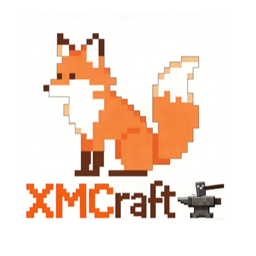

**简体中文** | [English](README-EN.md) | [繁體中文](README-ZH_TW.md)

<div align="center">



# PCL-梦港 (PCL-DreamPort)

[](https://github.com/XiamengYaro/PCL-DreamPort/)


[](https://github.com/XiamengYaro/PCL-DreamPort/issues)
[](https://github.com/XiamengYaro/PCL-DreamPort/pulls)

[](https://xmcraft.cn) <br />

[最新版本下载](https://github.com/XiamengYaro/PCL-DreamPort/releases/latest) |
[梦港官网](https://xmcraft.cn) |
[PCL 上游](https://github.com/Meloong-Git/PCL) |
[PCL CE 上游](https://github.com/PCL-Community/PCL-CE)

[提交问题](https://github.com/XiamengYaro/PCL-DreamPort/issues/new/choose) |
[贡献指南](CONTRIBUTING.md)

</div>

PCL-梦港（`PCL-DreamPort`）是面向夏日小镇 · 梦港服务器的专用启动器，也是第三方基于 [Plain Craft Launcher (PCL)](https://github.com/Meloong-Git/PCL) 与 [PCL Community Edition (PCL CE)](https://github.com/PCL-Community/PCL-CE) **独立二次创作**的跨平台衍生修改版。

> **独立二次创作声明**：本分支的版本号与原版 PCL / PCL CE 并非严格对应关系，**与龙腾猫跃及 PCL 官方无关联**。请勿向 PCL 或 PCL CE 上游仓库反馈本分支的问题。

## 相对上游的主要修改与新增能力

- **外观主题与跨平台体验**
  - **天依蓝默认主题**：新增天依蓝（`#66CCFF`）主题配色，并将浅色与深色模式默认配色均设为天依蓝，同时保证深色模式下表面层级保持暗色对比度。
  - **macOS 自绘标题栏**：macOS 默认启用无系统标题栏的「自绘标题栏」（隐藏系统标题栏与红黄绿按钮，右上角显示最小化与关闭按钮并保留原生圆角、阴影与八方向边缘缩放；支持在「设置 → 个性化 → macOS 标题栏样式」切换为独立、融入或自绘样式）。
  - **细节与环境适配**：重绘符合 Apple HIG 规范的 macOS 圆角应用图标；应用数据目录独立隔离为 `PCL-DreamPort`，不覆盖原有 PCL CE 数据；Java 自动发现覆盖 `PATH`、`JAVA_HOME` 及 macOS 系统/用户级 `JavaVirtualMachines`；修复启动后右侧主页焦点误滚至页面中部的问题。
- **合规底座、正版收口与源隔离**
  - **仅正版游戏账号**：屏蔽离线登录与外置登录入口，保留微软正版登录并内置设备码二维码渲染。
  - **合规约束保留**：严格保留双许可架构、「关于」页首位原作者龙腾猫跃署名与赞助链接以及启动劝导流程（`McLaunchPrecheck`）；Windows 界面主色相锁定 PCL 蓝色系；彻底禁用上游 Sentry 遥测、联机统计与 MirrorChyan 源。
  - **下载与加速源分工**：移除中国大陆地区的 Minecraft 下载、补全与整合包安装区域限制；游戏数据下载沿用 PCL 原生官方源 / BMCLAPI 并隔离下载层 User-Agent（`PCL-DreamPort/{version}`），梦港加速源（`https://dl.xmcraft.cn`，`DP_UPDATE_MIRROR_URL`）仅用于启动器更新等配套服务。
- **梦港账号、入服引导与社区集成**
  - **账号与多设备会话**：「工具 → 梦港账号」支持浏览器确认与同码手机扫码登录（`/api/qr-login/*`）、系统凭据库加密存储（DPAPI / Keychain）、严格区分会话过期（401）与网络波动，并支持活跃设备查看与单设备/批量踢出（`/api/auth/sessions*`）。
  - **原生六步入服引导**：对接 `/api/user/progress`，在启动器内原生完成 QQ 绑定/解绑（`/api/user/qq/*`）、使用当前已登录微软正版档案一键验证或设备码备用验证（`POST /api/user/minecraft/verify-token`）、邀请码入服（`POST /api/invite/apply`）、可交互入服问卷与 SSE 实时逐题 AI 评分反馈（`/api/questionnaire/{config,stream,submit}`），以及拒绝/封禁引导与人工复核申诉（`/api/questionnaire/appeal*`）。
  - **积分、称号、公告与自定义主页**：启动时自动为已过审玩家每日静默签到一次并去重（`POST /api/points/signin`），支持查看积分/任务并佩戴或卸下称号（`/api/points/center`、`/api/titles/*`）；新增「工具 → 公告与通知」及标题栏右上角未读通知角标（`/api/announcements`、`/api/notifications*`）；首页接入服务端下发与缓存版本比对（`GET /api/client/pcl-homepage`），支持 Hero 背景、轮播图、照片墙与公告同步，离线时静默回退至本地 XAML 原型。
- **梦港联机（TCP/TLS 中继）**
  - 完全移除 EasyTier 与 Natayark ID，原生实现仅基于 `DreamPort-Relay` 的 TCP/TLS 中继大厅与局域网广播发现：支持 `/realtime` WebSocket 秒级状态刷新（断连自动回退 30 秒轮询）、单人开房（`224.0.2.60:4445` 组播监听 + 游戏 `latest.log` 端口正则兜底与本机探活、SLP/本地模组扫描上报、10 秒 `host_status` 宽限保活、踢出/解禁、好友邀请与撤回、残留房间自救与退出自动关房），以及好友/公开大厅加房（兼容度排序、Forge/NeoForge 加载器与模组差异硬拦截、版本差异确认、多连接并发转发与局域网伪装广播）。
- **同步工具与 AI 辅助**
  - **双源模组同步、云存档与配置云同步**：「工具 → 同步与工具」接入 `/api/client/serverpack` 与 Modrinth 双源模组清单（版本/加载器前置校验、路径越界与核心文件保护、保留玩家自装与 `.disabled` 模组、SHA-256/512 校验）；支持流式存档 ZIP 打包云备份（跳过 `session.lock`、分块断点续传、Zip-Slip 校验与恢复时同名避让）；支持多设备白名单便携配置云同步（乐观锁 `revision` 冲突由玩家显式决策，严格排除账号凭据与本地路径参数）。
  - **AI 排障与资源解析**：「工具 → AI 排障」支持读取当前实例日志并在本机完成有界截取及玩家名/路径/令牌脱敏后异步诊断（`/api/ai/log-diagnose*`）；社区资源详情页提供「AI 功能解析」（`/api/ai/resource/explain`）。
- **双源自动更新与极简心跳**
  - **自动更新**：启动检查与「设置 → 更新」优先校验 `dl.xmcraft.cn/pcl-dreamport/{beta/}latest.json`（严格校验 schema / product / HTTPS / 64 位 SHA-256），任一不通过即静默回落 GitHub Releases + `SHA256SUMS`（覆盖 Windows/macOS/Linux 六平台 `.exe`、`.zip`、`.dmg`、`AppImage`、`.deb`、`.rpm`）；按 OS + 架构精准匹配应用内更新安装包格式，支持「跳过此版本」、`.dp-update-part` 落盘校验、Windows 原地自替换与 macOS `.app` 一键 `ditto` + `open -n` 重启。
  - **极简在线心跳**：仅在登录梦港账号后上报基础在线状态（`/api/client/heartbeat` 仅含 `clientVersion` / `platform` / `clientStartedAt`），不上传模组或本机配置；登出、切站或退出自动上报 `/api/client/offline`。

## 支持平台

本仓延续上游 `.NET 10` 轻量非自包含（`--no-self-contained`）构建与分发策略：

### Windows

| 版本 | 架构 | 支持情况 | 环境要求 |
|---|---|---|---|
| Windows 10 1809 (17763) 及以上，或 Windows 11 | x64、ARM64 | ✓ 完整支持 | [.NET 10 Desktop Runtime](https://get.dot.net/10) |
| Windows 10 1607 (E) | x64 | △ 理论能跑，酌情支持 | [.NET 10 Desktop Runtime](https://get.dot.net/10) |
| Windows 8.1、8、7 及更低版本 | / | ✗ 不支持 | / |

<small>`(E)` 指 Enterprise 或 ESU 版本。.NET 10 对 Windows 10 1607 和 1809 的官方支持仅限这些版本。</small>

### Linux

| 发行版 | 架构 | 支持情况 | 环境要求 |
|---|---|---|---|
| 常见 glibc 桌面发行版<br>（Ubuntu 22.04 及以上、Fedora 43 及以上、Arch Linux 等） | x64 | ✓ 支持 | [.NET 10 Runtime](https://get.dot.net/10)、X11、Wayland 实验 |
| 同上 | ARM64 | ✓ 支持 | [.NET 10 Runtime](https://get.dot.net/10)、X11 |
| 其他 glibc 桌面发行版 | x64、ARM64 | △ 理论能跑，酌情支持 | 需要 glibc 2.27 及以上，并能使用 X11 桌面 |
| Alpine 等 musl 发行版 | x64、ARM64 | ✗ 不支持 | 当前产物尚未在 musl 环境验证 |

<small>默认使用 X11。设置 `PCL_USE_WAYLAND=1` 可以尝试原生 Wayland，初始化失败会自动回退到 X11。使用 Wayland 还需要安装 `libwayland-client` 和 `libxkbcommon`。</small>

### macOS

| 版本 | 架构 | 支持情况 | 环境要求 |
|---|---|---|---|
| macOS 12 及以上 | Apple Silicon (ARM64)、Intel (x64) | ✓ 支持 | [.NET 10 Runtime](https://get.dot.net/10) |

<small>**macOS 首次启动说明**：当前公开构建使用 ad-hoc 签名，尚未经过 Apple Developer ID 公证。从官方 Release 或 `dl.xmcraft.cn` 下载安装后，如系统提示无法验证开发者或拒绝启动，可移除应用包隔离属性后再打开：</small>

```bash
xattr -dr com.apple.quarantine '/Applications/PCL-梦港.app'
open '/Applications/PCL-梦港.app'
```

**✓ 完整支持**：会尽量提供支持并持续修复兼容性问题，请先确保使用最新版本。

**△ 理论能跑，酌情支持**：这些平台通常可以运行，但无法保证所有功能正常。升级到受支持的系统版本可以获得更完整的支持。

**✗ 不支持**：这些平台基本无法正常使用，甚至可能无法启动。请升级系统后再运行 PCL-梦港。

**注**：
- 本项目只为最新版本提供支持。
- 有些问题与系统环境或缺少系统组件有关，需升级或补全运行环境后才能继续支持。
- 建议使用较新的操作系统以获得更好的体验。

## 构建与环境变量

构建本仓库需安装 **.NET 11 SDK**（溶液 `TargetFramework` 为 `net10.0`，`LangVersion 15.0`）。

```bash
# 构建 Debug / Release
dotnet build "PCL Community Edition.slnx" -c Debug
dotnet build "PCL Community Edition.slnx" -c Release

# 运行测试
dotnet test DreamPort.Test/DreamPort.Test.csproj -c Debug
dotnet test PCL.Core.Test/PCL.Core.Test.csproj -c Debug

# 打包与跨平台轻量发布（--no-self-contained，CI 发布工作流会自动生成 SHA256SUMS 供自动更新器校验）
PCL_SKIP_CODESIGN=1 bash scripts/package-macos.sh osx-arm64 Release 0.1.8 dist
bash scripts/publish-windows.sh win-x64 Release dist
bash scripts/publish.sh linux-x64 Release dist
```

Windows 发布物为单文件 `PCL.Launcher.exe`，发布流程会将其重命名为带版本和架构的 `.exe`。

| 环境变量 / 构建参数 | 默认值 | 说明 |
|---|---|---|
| `DP_BASE_URL` | `https://xmcraft.cn` | DreamPort 站点根地址 |
| `DP_REPO_URL` | `https://github.com/XiamengYaro/PCL-DreamPort` | 开源仓库地址 |
| `DP_UPDATE_MIRROR_URL` | `https://dl.xmcraft.cn` | 更新等配套服务下载加速源（不用于游戏数据下载） |
| `PCL_MS_CLIENT_ID` | （必填） | 自有 Azure 正版登录 Client ID（构建期注入；Debug 支持 `DP_MS_CLIENT_ID`） |

## 许可证

- `PCL.Launcher/` 和 `PCL.Launcher.Core/` 目录严格适用并延续 [PCL 自定义分发有限许可及合理使用指南](PCL.Launcher.Core/LICENCE)
- `DreamPort.Core/`、`DreamPort.UI/`、`DreamPort.Test/` 及 `其余所有目录` 使用 [Apache License 2.0](LICENSE)（衍生变更与第三方归属声明详见 [NOTICE](NOTICE)）

## 统计数据

[](https://www.star-history.com/#XiamengYaro/PCL-DreamPort&Date)

## 贡献者

感谢原作者龙腾猫跃及上游 [PCL Community Edition](https://github.com/PCL-Community/PCL-CE) 社区的长期贡献，以及参与 `PCL-DreamPort` 构建与测试的每一位开发者：

[](https://github.com/XiamengYaro/PCL-DreamPort/graphs/contributors)
